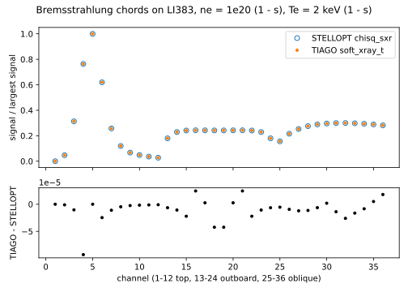

# Soft X-ray chords: TIAGO vs. STELLOPT

Compares TIAGO's soft X-ray line integrals (`soft_xray_t`, bremsstrahlung
model without filter) with STELLOPT's own synthetic SXR signal on the same
equilibrium, chords and profiles.

DIAGNO has no emissivity or SXR model; it computes magnetic diagnostics only.
The reference is therefore STELLOPT's optimizer target `chisq_sxr`
(`STELLOPTV2/Sources/Chisq/chisq_sxr.f90`), which integrates
`fcn_sxr = Zeff ne^2 Te^(1/2)` (`equil_utils.f90`) along each chord with
LIBSTELL's `line_int` (512 steps, each two three-point panels) and divides all signals
by the largest one. TIAGO's integrand is the same up to the constant
1.69e-38 W m^3 eV^(-1/2); both are compared after the same normalization.

This is a manual benchmark, not part of `ctest`. It needs docker and builds
STELLOPT once, serially, in its CI container (parallel `build_all` runs can
fail on module-order races).

```bash
cmake -S . -B build && cmake --build build     # TIAGO, see the top-level README
benchmarks/sxr/run.sh build                     # writes benchmarks/sxr/_work/
```

`run.sh` builds STELLOPT at a pinned commit in the pinned
`lazerson/stellopt-compile` image, runs one STELLOPT evaluation (`ONE_ITER`) of
the simsopt `input.li383_low_res` case with VMEC, evaluates the same chords
with TIAGO on STELLOPT's `wout`, and writes `results.md`, `results.csv` and the
logs to `_work/`. `benchmark_sxr` defines the shared inputs once: three cameras
of 12 channels (above the plasma and outboard in the plane phi = 0, and an
oblique fan at phi = 18 degrees), `ne = 1e20 (1 - s)` m^-3,
`Te = 2 keV (1 - s)`, `Zeff = 1.5`, all as STELLOPT power series in `s`.
Zeff is given as a power series like ne because `fcn_sxr` evaluates Zeff with
the density profile type `NE_TYPE`.

## Result (2026-11-16)

[results/2026-11-16](results/2026-11-16/results.md):

| camera | channels | max abs difference | median abs difference |
| --- | --- | --- | --- |
| top | 12 | 9.3e-05 | 2.1e-06 |
| outboard | 12 | 4.2e-05 | 1.6e-05 |
| oblique | 12 | 2.6e-05 | 1.1e-05 |
| all | 36 | 9.3e-05 | 9.9e-06 |

Differences are in units of the largest signal. TIAGO's result changes by at
most 2.4e-10 between 800 and 1600 panels of four Gauss points, so the
difference is dominated by the reference's fixed 512-step rule and its point
inversion. The normalization removes any common factor; TIAGO's absolute
coefficient is checked against closed forms in `tiago_soft_xray`.
Filtered emission and the emissivity-profile model have no STELLOPT
counterpart and are checked only against the analytic and quadrature oracles
of [docs/soft-xray.md](../../docs/soft-xray.md#verification).


