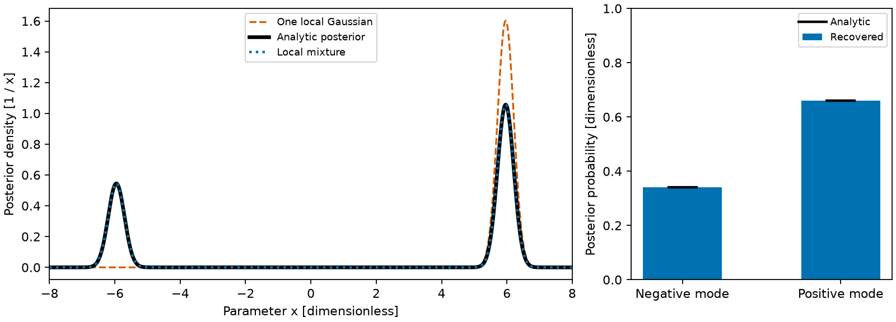

# Joint equilibrium and profile inference

Status: in development on branch `inference/core-20261026`. The VMEC++
magnetic reconstruction (`tiago_reconstruct`, README and STATUS.md) is
unchanged and remains the benchmarked reference path. This document is the
contract for the inference core and for the profile diagnostics built on it.

## Linear Gaussian conditional fits

`tiago_linear_posterior::linear_posterior_t` represents whitened observations
with a fixed design matrix and independent zero-mean Gaussian parameter priors.
`configure(design, data, log_likelihood_normalization, sd, status)` accepts
finite arrays, positive prior standard deviations and the complete likelihood
normalization. Proper priors also permit fewer observations than parameters.
Correlated priors and observational covariance can be transformed into these
coordinates by the caller.

`tiago_linear_infer INPUT OUTPUT` solves independent cases with LAPACK and uses
the shared Laplace engine for exact Gaussian covariance and evidence. Cases run
in parallel when OpenMP is enabled. The input is whitespace-delimited:

```text
number_of_cases
m n log_likelihood_normalization
prior_standard_deviations(1:n)
whitened_observation_1 whitened_design_row_1(1:n)
... m observation rows, followed by the next case ...
```

The output for each case is its one-based index, parameter count, log evidence
and squared residual norm, followed by one mean vector and `n` covariance rows.
The residual norm includes the Gaussian prior penalty. The caller must retain
all normalization constants and any orthogonal residual when compressing data;
omitting them changes model evidence even if the parameter fit is unchanged.
This conditional calculation does not establish completeness of nonlinear
posterior modes or suitability of a profile or calibration prior.

## Generative model

The latent parameters are defined on the input side and never inverted from
outputs:

- kinetic profiles ne, Te, Ti, Zeff and a fast-particle pressure nuisance
  p_fast as functions of the provider's flux label s;
- the toroidal current (CURTOR and the AC coefficients of VMEC's current
  profile), the boundary and PHIEDGE parameters of the existing chain;
- coil-group currents (EXTCUR) with Gaussian priors from their measurements;
- diagnostic alignment nuisances (owned by each diagnostic) and calibration
  gains/offsets (owned by the likelihood).

For given latents the provider solves the equilibrium with the derived
pressure p = ne Te + (n_D + n_Z) Ti + p_fast (main ions D and one impurity of
charge Z_imp fixed by Zeff), all signals are predicted in real space, and the
likelihood compares them with the data. There is no outer fixed point between
profile fitting and equilibrium fitting.

## Profile-diagnostic interface

Module `tiago_profile_diagnostic` (`src/inference/profile_diagnostic.f90`,
library `tiago_inference`, built without VMEC++) defines the contract. A
diagnostic extends `profile_diagnostic_t` and implements:

| procedure | meaning |
|---|---|
| `n_signals()` | number of predicted signals |
| `n_nuisance()` | number of its own alignment parameters eta |
| `label(i)` | name of signal i |
| `sample_points(eta, x, dx_deta)` | real-space points x(3, n_points) as (R [m], phi [rad], Z [m]) and dx/deta (3, n_points, n_nuisance) |
| `predict(sample, eta, y)` | signals from the sampled quantities |
| `jvp(sample, eta, q_dot, eta_dot, y_dot)` | tangent at fixed points |
| `vjp(sample, eta, y_bar, q_bar, eta_bar)` | adjoint at fixed points |

`plasma_sample_t` holds, for each point, the quantities
`q(N_QUANTITIES, n)` with rows `Q_S` (normalized toroidal flux s, extrapolated
above 1 outside the plasma), `Q_B` (|B| in T), `Q_NE` (m^-3), `Q_TE` and
`Q_TI` (eV) and `Q_ZEFF`, their spatial derivatives `dq_dx(3, N_QUANTITIES, n)`
with respect to (R, phi, Z), and `inside(n)`. Outside the last closed surface
the kinetic profiles continue as f(1) exp(-(s - 1) / sol_decay) (Zeff
constant, sol_decay = 0.05 by default), so predictions remain continuous and
differentiable when a point crosses the boundary during sampling.

The core evaluates the sample, calls the diagnostic and composes the chain
rule: the diagnostic's q_bar goes through the profiles to the profile latents
and through s and |B| to the provider's implicit adjoint; the motion of the
points adds `sum(q_bar * dq_dx . dx_deta)` to eta_bar. A diagnostic therefore
needs only local derivatives and is testable without an equilibrium:
`check_diagnostic_derivatives` compares `jvp` with central differences of
`predict` and checks the adjoint identity <y_bar, J v> = <J^T y_bar, v>.

Rules for diagnostic authors:

- Instrument semantics (scattering volumes, spectral or antenna response,
  lines of sight and their quadrature, cold resonance location) live in the
  diagnostic. Line integrals choose their own quadrature points; a resonance
  search samples |B| along the line and differentiates the located position
  through q_bar(Q_B).
- The measurement covariance, shared calibration gains/offsets and the
  model-error term belong to the likelihood (`tiago_likelihood`), not to the
  diagnostic.
- Private machine geometry is read at run time; it never enters the repository.

Recorded-signal extensions, versioned sources, reductions and calibration priors
are specified in [recorded-signals.md](recorded-signals.md). They use the same
state vector and derivative contract.

`tiago_point_probe` is the reference implementation (ideal local ne/Te/Ti
values with a rigid (dR, dZ) alignment shift) used by the synthetic tests.

## Provider states and point location

Points are located in a provider state through `tiago_real_space_state`
(`real_space_state_t`: labels u = (rho, theta, phi) to Cartesian x and |B|,
parameter JVP/VJP at fixed labels, Newton location and implicit-function
derivatives; introduced with the synthetic-diagnostics work). There is one
location path. `tiago_state_sampler` fills the rows Q_S and Q_B of a
`plasma_sample_t` and maps their cotangents to the state parameters.

`tiago_vmecpp_state` implements the interface for a solved VMEC++
equilibrium. Its parameters are the solver's geometry coefficients (the
cotangent the implicit adjoint accepts) followed by the |B| spectrum bmnc,
each a C1 Hermite interpolant in rho. The joint model passes the geometry
cotangent to `tiago_equilibrium%jacobian` (`coef_cot`) and the bmnc
cotangent as `bmnc_cot`. VMEC++ has no adjoint of its output stage, so Tiago
recomputes |B| on the half grid from the geometry coefficients, phi', iota and
the enclosed current as VMEC's bcovar does (|B|^2 = B^u B_u + B^v B_v,
`vmec_edge%modb`, equal to the wout bmnc to round-off) and differentiates that
by hand (`vmec_edge%modb_vjp`). The geometry part of its cotangent goes
through the VMEC++ implicit adjoint, the direct iota and current parts join
the profile cotangents, and PHIEDGE uses the same scaling argument as the
edge field. |B| at a fixed label therefore has complete derivatives with
respect to the equilibrium inputs, which diagnostics that read |B| (ECE)
need.

## Likelihood and engines

`tiago_joint_model` stacks the magnetic rows of `tiago_reconstruction`
(whitened with a full covariance plus a model-error variance), the
free-boundary consistency rows and parameter priors, the profile diagnostics
L^-1 (g y - d) with their own full covariance, model-error term, alignment
and gain nuisances, and N(0, I) rows for the latent priors. The kinetic
pressure enters VMEC++ as a line-segment profile with knots at the half-grid
surfaces, so the solver's pressure cotangents apply directly.

`tiago_inference_engines` provides the MAP (Levenberg-Marquardt; VMEC++
hot-restarts from the previous equilibrium), the Laplace covariance and log
evidence, NUTS from fortnum with the Laplace covariance as dense metric, and
Pareto-smoothed importance sampling from the Laplace Gaussian (k-hat).
`tiago_infer` runs the synthetic study (truth drawn from the prior, synthetic
noise, MAP, Laplace, PSIS, NUTS) and writes CSV files for
`tools/inference_plots.py` and `tools/inference_coverage.py`.

## Synthetic coverage study (LI383, fixed boundary)

sCluster array 3370173 ran 50 seeds of `tiago_infer` at c2328c8 (seeds
101-150; Clang 22.1.8 / Enzyme 0.0.293, 4 threads each, 10 to 24 min per
seed). Each seed draws the truth from the prior (CURTOR, PHIEDGE, 7 B-spline
latents each for ne, Te, Ti, a (dR, dZ) probe alignment: 25 latents), adds
noise to 54 magnetic signals and 24 profile probes (5 %), and runs MAP,
Laplace, PSIS (400 draws), NUTS (300 warm-up, 400 draws) and 400 re-solved
draws for iota (flux surfaces are written for the first 40). Fractions of
truths inside the central intervals (nominal 0.683/0.954 for +-1/2 sd,
0.68/0.95 for quantile intervals; brackets are 95 % seed-bootstrap
intervals):

| | 68 % | 95 % |
|---|---|---|
| latents, Laplace | 0.671 [0.643, 0.699] | 0.938 [0.920, 0.954] |
| latents, NUTS | 0.670 [0.643, 0.694] | 0.929 [0.911, 0.946] |
| ne, Te, Ti, p at 41 s values, Laplace | 0.665 [0.636, 0.692] | 0.937 [0.920, 0.952] |
| same, NUTS | 0.675 [0.646, 0.703] | 0.940 [0.923, 0.955] |
| iota, 400 re-solved draws | 0.724 [0.641, 0.804] | 0.949 [0.908, 0.983] |

The empirical quantile band of N independent draws contains a calibrated
truth with probability 0.676/0.946 for N = 400 (Monte Carlo), so the
expected values for the draw-based rows are 0.676/0.945 (NUTS) and
0.676/0.945 (iota); all intervals contain them. Values within a seed are
correlated, so `tools/inference_coverage.py` resamples whole seeds, and
binomial intervals over all counted values understate the uncertainty, most
for iota, whose values at all s follow CURTOR. Per latent (one trial per
seed, Wilson 95 % intervals of roughly +-0.13) the Laplace coverage lies
between 0.54 and 0.82 at 68 % and between 0.84 and 1.00 at 95 %. The lowest
is the alignment latent align_1 (0.54 [0.40, 0.67], 0.84 [0.71, 0.92]),
which is the one outlier expected among 25 latents at this precision;
CURTOR has 0.64 [0.50, 0.76] and 0.92 [0.81, 0.97].
`tools/inference_coverage.py` writes this table (`coverage_parameters.txt`)
and the per-latent calibration figure. NUTS had no divergences, mean
acceptance 0.80-0.85, tree depth 3 and E-BFMI 0.9-1.4; PSIS k-hat had
median 0.43 and exceeded 0.7 in one seed.

The magnetics constrain CURTOR strongly: the median Laplace sd is 0.0185 of
the prior sd (about 370 A of the 2e4 A prior), and the joint Fisher
information from the magnetic rows equals that of `tiago_reconstruction`.
Consequently the iota posterior sd is small (median over seeds 0.002 at the
sixth and 0.005 at the third-last of the 15 half-grid surfaces, against about
0.02 before the fix) and the remaining profile uncertainty is that of the
kinetic latents: the posterior sd is 0.17 of the prior sd for the leading
B-spline latent of each of ne, Te, Ti, but 0.5 to 1.0 for the others, so the
profile diagnostics, not the magnetics, limit ne, Te, Ti at mid radius and
the edge, and PHIEDGE keeps 0.60 of its prior sd. The synthetic magnetics
must be whitened with the sigmas that `synthesize_magnetics` sets, which the
joint model now does (a regression test compares the joint magnetic Fisher
information with the reconstruction rows). `tools/inference_plots.py`
writes, for one seed, flux surfaces at three toroidal angles with 68/95 %
bands of the displacement from the truth, profiles (p, ne, Te, Ti, iota,
enclosed current) with bands, and the corner plot.

## Diagnostic calibration as nuisance parameters

A Thomson scattering system predicts the pair
(ne, Te) per scattering volume, and a calibration factor multiplies every
spectral channel. Thomson data alone therefore fix only the product of the
factor and ne, while Te from channel ratios is calibration independent
(Fischer, Dinklage and Pasch 2003, PPCF 45, 1095). The calibration is
modelled as latent parameters beside the profile latents, so that its
uncertainty propagates into the posterior of the profiles and the equilibrium:

    ne_obs = exp(lc + a) ne + noise,    Te_obs unchanged.

### Implemented: Thomson density calibration

Thomson scattering measures the product C ne of the density and an absolute
calibration factor C, while Te follows from the spectral shape and does not
depend on C. A diagnostic slot of the joint model can therefore carry a
log-scale calibration (`cal_sigma > 0`). Signal i with `cal_group(i) = l > 0`
is multiplied by exp(log C + b_l), and signals with group 0 are not scaled
(`thomson_t%calibration_groups()` maps ne_i to its laser and Te_i to 0).

- Campaign scale: log C = `cal_mean` + `cal_sigma` z_C with z_C ~ N(0, 1)
  (default width 0.5, so that P(C in [1/2, 2]) = 0.83), or a unit Student-t
  with `cal_nu` degrees of freedom for heavier tails. The t prior enters the
  residual as the row sign(z) sqrt(2 phi(z)) with phi = (nu + 1)/2 log(1 + z^2/nu)
  from the FortSym kernel `student_t_prior`, and `log_normalization` adds
  its normalization. The Laplace Hessian of that row is the Gauss-Newton one.
- Per-laser offsets (`laser_sigma > 0` and more than one laser):
  b = `laser_sigma` H z_b with the orthonormal Helmert contrasts H, which have
  L - 1 columns orthogonal to the ones vector. The offsets therefore sum to
  zero, each has the prior sd `laser_sigma` sqrt(1 - 1/L), and log C is the
  mean log scale over the lasers.
- Shared systematic of the interferometer: the same latent on the
  interferometer slot with every chord in group 1 (prior sd 0.03 in
  `tiago_infer`) represents a common path-length or geometry error. Without
  it, a chord fixes log C to the statistical noise, which is a false
  precision. With it, the precision of C is limited by that systematic.

The derivatives d(c y)/dz are c y times the latent's coefficient. All other
cotangents of a row, which enter through the profiles, the alignment and the
equilibrium adjoint, are scaled by c, as for the linear gain.
`tests/test_calibration.f90` checks the layout, the zero-sum offsets,
unscaled Te, the data reproduced at a C = 1.8 truth, the Jacobian columns of
all calibration latents, a profile latent and CURTOR against central
differences of re-solved equilibria, the t prior row and its series branch,
and the normalization against quadrature.

`tiago_infer` with `calibration_case = 1..4` runs the identifiability study.
In case 1 only Thomson is used, without magnetics. Case 2 adds an
interferometer with three horizontal chords, case 3 the diamagnetic loops of
the synthetic sensor set, and case 4 all magnetic signals and the Ti probes.
The truth has a fixed `ts_cal_truth` and fixed laser offsets
`ts_laser_truth` (with their mean removed), while all other latents are
drawn from the prior. With `ts_cal_sigma = 0` the same data are fitted
without the latent. `tools/calibration_study.py` reports, for each variant,
the posterior of log C, its contraction relative to the prior, the bias and
the coverage, and it plots the posterior of C against the truth and the ne
bands with and without the latent.

A single run on seed 101 with C = 1.8 and Te0 = 2.5 keV gives a log C
posterior sd of 0.28, 0.07, 0.07 and 0.05 of the prior sd in cases 1 to 4.
Even Thomson alone therefore constrains C here, through the pressure: at a
fixed boundary, C ne sets the Shafranov shift that the inboard and outboard
volumes at fixed real-space positions see. The contraction is 0.71 at
Te0 = 250 eV and 0.96 at 25 eV, and it does not change with the width of the
ne prior (0.3 to 10). Without the calibration latent, the ne posterior misses
the truth by the factor C, and the interferometer systematic absorbs it
(MAP at -15 prior sd).

### Not yet implemented

- One-sided overlap loss: a is not positive. Laser misalignment lowers the
  inferred density and changes it per laser and per volume (Merlo et al. 2023,
  JINST 18, P11012, Nelde et al., arXiv:2111.03562). It is modelled as a
  transformed smooth function of radius and time, or of the measured beam
  shift where available, with the extra per-channel scatter as a latent.
- Cross-calibration: a line-integral interferometer along a nearly identical
  chord (Kwak et al. 2024, Nucl. Fusion 64, 106022), the diamagnetic energy
  with the temperature profiles and the dilution, and absolute cutoffs such as
  the ECE cutoff in a density ramp. The interferometer constrains the scale
  only up to the unobserved edge density, and the diamagnetic energy depends
  on Ti and fast ions, so these anchors have independent systematics. Pooling
  several shots needs one shared interferometer systematic, otherwise the
  campaign scale gets a false precision below that floor.
- Identifiability: through the profiles alone the posterior of lc would equal its prior, but the
  implemented study above finds that the pressure constraint on the equilibrium
  contracts it.
  The contraction of the posterior relative to the prior, a leave-one-diagnostic-out
  predictive check and the evidence of fixed against free scale quantify what
  the other diagnostics pin down. A shape discrepancy, if added, needs zero
  mean, small amplitude and no constant mode, because an unconstrained
  discrepancy absorbs the scale (Kennedy and O'Hagan 2001, JRSS-B 63, 425).

Planned extension of the synthetic test: inject a scale error in both directions, laser offsets
and a one-sided overlap loss in the truth, and run diagnostic sets from
Thomson alone through the interferometer, the diamagnetic energy, edge beam
data and an ECE cutoff ramp up to a multi-shot hierarchy. The richer sets must show small bias and
nominal 68 % and 95 % coverage over at least 50 seeds with flat
simulation-based-calibration ranks (Talts et al. 2018, arXiv:1804.06788), using
the coverage machinery of the study below.

## References and reference implementations

- Profile prior kernel: the non-stationary Gibbs kernel with a tanh
  core/edge length scale (Gibbs 1997; Paciorek and Schervish 2004, NIPS 16),
  as used in Minerva and in Köberl's surroBIER. TIAGO
  applies it to the log-profile values directly instead of to the log of the
  gradient, so plateaus (flattening) remain in the support of the prior.
- surroBIER (R. Köberl, MPCDF, MIT) and vmecnn (A. Merlo, MPCDF; Merlo et al.
  2023, JINST 18 P11012) are surrogate-based comparisons; TIAGO runs the
  VMEC++ solver and its implicit adjoint inside the inference instead.

Chris&AI

## Several local modes

`tiago_local_mixture::multi_start_map` searches supplied candidates and prior
starts independently, then returns `local_mixture_t%modes`. It accepts either
`joint_model_t` or `tiago_reconstruction_posterior::reconstruction_posterior_t`.
Both use the existing MAP, Laplace and PSIS engines; NUTS remains
available separately for each mode through `sample_nuts`. Equilibrium solves
are serial because the reconstruction provider has shared mutable state.

```fortran
type(mode_start_t) :: starts(10)
type(mixture_options_t) :: options
type(local_mixture_t) :: mixture
! Set up model, measurements and priors first; create results/modes.
starts(1)%theta = candidate_a
starts(2)%theta = candidate_b
! An unallocated theta requests one independent draw from the active prior.
call multi_start_map(model, starts, size(candidate_a), 'results/modes', &
    options, mixture, status)
```

Candidate vectors use the same coordinates as `map_fit`: reconstruction
parameters divided by `rec%scale`, followed, for the joint model, by the
standard-normal profile and instrument latents. Prior starts draw reconstruction
parameters from their declared Gaussian priors in these scaled coordinates and
all joint latents from independent standard normals. Correlated physical
profile/calibration priors are already represented by their latent transforms.
A prior draw with no solvable equilibrium is recorded as a failed start; it is
not redrawn or silently used to truncate or renormalize the prior.

For alternative pressure models or equilibrium branches, give each distinct
model/branch and parameter chart its own `mode_start_t%family`. Supply the
optional `prepare(index, model, ok)` callback to activate that start's complete
model and initial equilibrium before either drawing its prior or optimizing.
The callback must restore all model configuration, data and priors, including
a branch-specific solver initial state when required. The engine invalidates
caches and disables the joint proposal surrogate after activation. All starts
in one call have the same parameter dimension; their interpretations may differ
between families. A family must have the same posterior and coordinate chart
for every start. Distinct equilibria that share parameter values need distinct
family identifiers. There is no automatic physical branch discovery.

Assign `log_family_prior` the logarithm of the prior probability of its discrete
model/branch. Probabilities over distinct families must sum to one; the default
zero is appropriate for a single family. Repeated starts in a family must use
the same probability. An optimizer start is not itself a model, and finding a
mode repeatedly never increases its posterior weight. Families with different
observations, signal units or likelihood measures cannot be compared by these
weights. Comparisons must include the same data and their complete likelihood
normalizations.

Within a family, two fits are duplicates if the displacement of their means
has Mahalanobis distance at most `dedup_distance` (default 1) under **both**
local covariance matrices. The lower-chi-squared fit is retained. The two
metrics prevent a broad approximation from swallowing a narrow one. An
iteration limit, a stalled optimizer, a failed equilibrium or a failed Laplace
factorization is reported in `starts.csv` and excluded. Convergence uses the
existing predicted chi-squared decrease threshold (default 0.001); set
`decrease_tolerance` with regard to the forward solver's numerical accuracy.
This search does not certify that all modes have been found.

Each mode has a Gaussian with its own mean, covariance and Cholesky factor.
The default Hessian is the Gauss–Newton approximation `H = J^T J` of the
whitened posterior residual. Models requesting `observed_curvature()` use
the finite-difference observed posterior Hessian. Qualify the chosen
curvature for the target posterior.
Its log evidence is

    log Z_k = -chi2_k/2 + c_k + n/2 log(2 pi) - log det(H_k)/2.

Here `c_k = log_normalization()` includes the normalized measurement
likelihoods, consistency rows and priors. In particular, a reconstruction
prior contributes `-log(sigma_prior/scale) - log(2 pi)/2`, and each
standard-normal latent contributes `-log(2 pi)/2`. Instrument transformations
act inside the forward model; evidence is integrated in the declared latent
coordinates. The mode weights are the normalized exponentials of
`log Z_k + log_family_prior`, computed after subtracting the largest value.
The mixture evidence is their log-sum-exp, conditional on the modes found.
Improper reconstruction priors leave local Gaussians available but set
`evidence_valid` false and mixture weights and evidence to NaN. The raw local
evidence column is then only a formal value with the proper-prior flag false.
A large PSIS k-hat warns about the local Gaussian; it does not correct its
Laplace evidence or establish that no other mode exists.

The output directory must exist. `modes.csv` records each mode's source start,
family, weight, local evidence, discrete prior, log Hessian determinant, joint
normalization, proper-prior flag, total posterior chi-squared, residual count,
maximum absolute posterior gradient, iteration count, PSIS k-hat, effective
sample size, failed draws and equilibrium filename. `starts.csv` records every
attempt and its convergence message. `mode_<k>_parameters.csv` and
`mode_<k>_covariance.csv` contain the MAP and covariance in inference coordinates.
`mode_<k>_residuals.csv` contains its whitened posterior residual rows.
Each physical mode has a separate `mode_<k>.nc`, saved at its MAP after PSIS.
Repeated calls overwrite these report names; only rows in the current
`modes.csv` identify retained modes.

`sample_local_mixture` draws a mode according to its evidence weight and then
a parameter vector from that mode's Gaussian. Its returned mode index selects
the family and saved equilibrium to activate before a physical prediction;
`modes(k)%start` identifies the corresponding preparation callback. Predictions
and uncertainty bands may be combined with their weights. Equilibria themselves
are never averaged, and the API supplies no averaged equilibrium.

The public `tiago_local_mixture` test uses a synthetic measurement of `abs(x)`
with Gaussian noise, a datum of 6, noise standard deviation 0.25 and prior
`x ~ N(0.5, 3^2)` (all dimensionless). Its two separated local posteriors are
Gaussian up to negligible half-line tails. Their analytic positive/negative
evidence ratio is `exp(2*6*0.5/(3^2 + 0.25^2)) = 1.93879950`.
The test checks both modes, their absolute evidence and covariance, duplicate
and prior-only starts, state restoration after PSIS, discrete family priors,
failed starts and the unimodal signed-measurement limit. It does not validate
discovery of competing experimental equilibria.



The figure compares one local Gaussian with the evidence-weighted mixture and
the normalized analytic posterior. Reproduce it with
`python tools/local_mixture_plot.py build/tests/local_mixture/two_mode docs/figures/local-mixture.png`
after running the test. The synthetic observations and prior are stated above;
no experimental data enter this check.

## Synthetic temporal inference check

The `tiago_temporal_inference` CTest checks the existing maximum a posteriori
(MAP), Laplace and evidence-weighted family machinery against exact Gaussian
conditioning. It regenerates dimensionless synthetic observations for forty
plasma times, three sensor offsets and three temporally correlated sensor drifts.
Independent stationary first-order autoregressive priors describe plasma and
drift; independent Gaussian priors describe offsets. Ninety-two retained sensor
observations measure plasma plus offset and drift, while five trusted anchors
measure only plasma. Missing observations are omitted.

Four equally probable families combine drift standard deviations of 0.12 or
0.30 with adjacent-time correlations of 0.30 or 0.94. A family callback activates
each covariance before the production `multi_start_map` call, and repeated starts
must collapse within each family. The Fortran fixture assembles normalized
innovation residuals through `local_posterior_t`; the independent Python
standard-library oracle conditions a directly constructed dense stationary
covariance in observation space. Every component mean, full covariance, absolute
log evidence and family weight is checked, as is exact Gaussian importance
sampling.

The check also removes anchors and generates drift outside the candidate
covariance set. Oracle agreement verifies the computation even under model
misspecification; single-realization errors and interval coverage are descriptive,
not calibration claims. This toy does not connect temporal states to the joint
equilibrium reconstruction. Run it with
`ctest --test-dir build -R tiago_temporal_inference --output-on-failure`.
The checker accepts `--times` for smaller exploratory cases and needs no NumPy
installation, external data or equilibrium solver.

## Comparing models with different dimensions

Fit each physical model in its own `multi_start_map` call when its parameter
count differs. Each call first combines that model's local modes. Then
`compare_local_mixtures` combines the model evidences with normalized model
priors:

```fortran
type(local_mixture_t) :: models(2)
real(real64), allocatable :: probability(:)
real(real64) :: log_evidence
! Populate models(1) and models(2) with separate multi_start_map calls.
call compare_local_mixtures(models, log([0.7_real64, 0.3_real64]), &
    probability, log_evidence, status)
```

The example assigns prior probabilities 0.7 and 0.3. `probability` contains
the resulting model probabilities; `log_evidence` is the evidence of their
model-averaged data distribution. Use the same observations, likelihood
measure and compatible shared-parameter priors in both models. The routine
rejects absent, improper or nonfinite evidences and unnormalized model priors.
It cannot establish mode completeness or the accuracy of the supplied
Laplace approximations. In particular, `evidence_valid` checks formal inputs,
not experimental or approximation qualification.

A no-island model has an atom at zero width and no island phase. Its
probability is separate from the island model's continuous width distribution.
Report model probabilities and any physically useful width exceedance
probability explicitly. A continuous prior alone gives zero probability to
exactly zero width. A local mixture is a Laplace approximation, not a
variationally optimized distribution.

`tiago_model_comparison` checks the composition against independent numerical
integration after analytically marginalizing a shared Gaussian nuisance. Its
dimensionless observations measure a common level and that level plus an
absolute-valued signature. The alternative has two sign aliases; they are
not physical island phases, and the signature is not an island width. The
check covers different parameter dimensions, unequal model priors, duplicate
starts, a strong signature, a weak signature and zero sensitivity. In the
Gaussian regime, absolute evidence and model probabilities agree with the
reference. A near-boundary case deliberately exposes inaccurate local
Gaussian evidence. Such results require a more suitable approximation or a
reference calculation before scientific use. The same test verifies that a
large constant residual does not stall the MAP fit.
