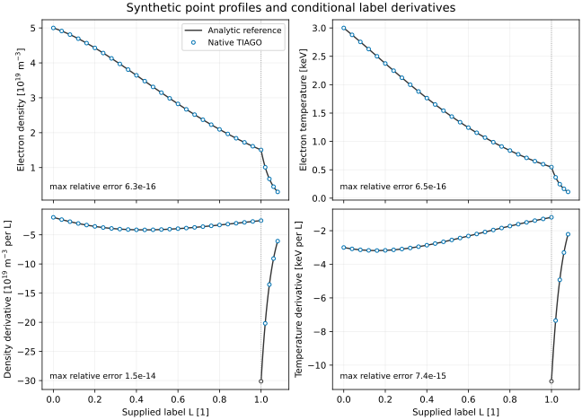

# Point profiles at field-line labels

`tiago_profile_points input.nml` evaluates fixed electron density and
temperature profiles at supplied labels L, using the same profile evaluator
as TIAGO's inference and synthetic diagnostics. It also writes ion temperature,
effective charge and the derivative of each profile with respect to L.
Repeated labels give identical values, including on an island plateau.

These are ideal local observables: ne and Te at a Thomson scattering point,
and Te at an electron cyclotron emission (ECE) point if the emission is
optically thick and the supplied point is the emitting location. Volume
averaging, radiative transfer, calibration and the location of the ECE
resonance remain separate instrument models.

```text
&profile_points
  profiles = 'profiles.nc'
  labels = 'labels.txt'
  output = 'points.nc'
  profile_knots = 12
  sol_decay = 0.05
/
```

`labels.txt` contains one finite nonnegative L per nonblank line, in output
order, with no additional fields.
The caller supplies its physical definition and numerical uncertainty. For
example, `tiago_field_line_labels` computes the mean reference flux label
over returns of a field line to the diagnostic plane. The command does not
trace field lines or substitute a nominal label for a failed trace.

The netCDF profile table is the existing `tiago_synth` format: vectors
`s`, `ne` [m^-3], `te` [eV], `ti` [eV] and optionally `zeff` on s in [0, 1].
It needs at least `profile_knots + 3` samples. Density and temperatures must
be positive, and a supplied Zeff must lie strictly between 1 and 6. Omitted
Zeff retains the default 1. The table is fitted by cubic B-splines in log
space (logit space for Zeff); it is evaluated at s = L. A profile whose transformed
value (log for density and temperatures, logit for Zeff) is cubic is
represented exactly on [0, 1] up to roundoff. Other profiles
have a representation error that must be checked separately from the
operator and field-line-label errors.

For L > 1, the existing profile evaluator continues density and temperatures
as f(1) exp(-(L - 1) / sol_decay), while Zeff remains fixed at Zeff(1).
The positive parameter `sol_decay` is an e-folding length in the dimensionless
label, not a spatial length. This continuation is a chosen scrape-off-layer
model and does not extend the measured profile. At L = 1 the returned slope is the
interior spline slope; the continuation can introduce a slope jump there.

The output has dimension `point` and preserves the input order:

| Variable | Units | Meaning |
|---|---|---|
| `label` | 1 | supplied L |
| `ne`, `d_ne_dlabel` | m^-3 | electron density and its derivative with respect to L |
| `te`, `d_te_dlabel` | eV | electron temperature and its derivative with respect to L |
| `ti`, `d_ti_dlabel` | eV | ion temperature and its derivative with respect to L |
| `zeff`, `d_zeff_dlabel` | 1 | effective charge and its derivative with respect to L |

Global attributes record the TIAGO revision, input paths and SHA-256 hashes,
the number of profile intervals and the scrape-off decay length.
The command rejects an output path that aliases an input file. The derivatives are conditional on the
supplied labels and fitted profiles. They are not spatial derivatives or
derivatives through the magnetic field or field-line tracing.

The native test compares values and label derivatives with closed-form
exponentials of cubic polynomials, checks repeated plateau labels, and rejects
non-finite profiles and labels, negative labels, extra fields and malformed
inputs. It also checks the scrape-off continuation and preservation of input
files when output paths alias them.


