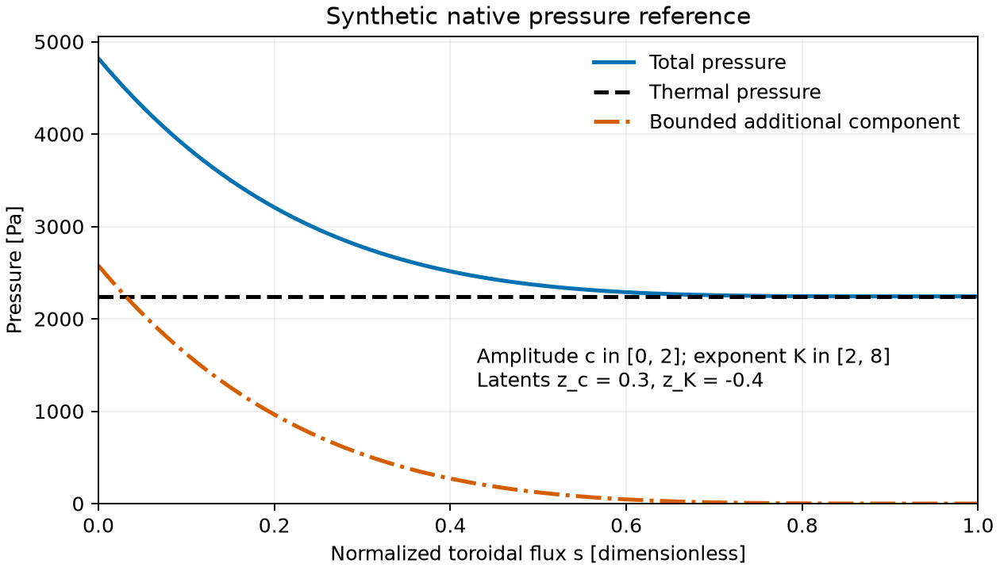

# Equilibrium reconstruction with `tiago_reconstruct`

`tiago_reconstruct input.nml` fits the parameters of a VMEC input to measured
flux loops, segmented Rogowski coils and magnetic probes. It requires a build
with `-DTIAGO_ENABLE_RECONSTRUCTION=ON` ([building.md](building.md)). It
minimises

    chi^2 = sum_i ((S_i(x) - m_i) / sigma_i)^2 + consistency + priors

with Levenberg–Marquardt (in Fortran, on LAPACK) and reports the linearised
covariance `(J^T J)^-1`. Each evaluation of `S(x)` solves the prescribed fixed- or free-boundary
equilibrium with VMEC++, builds the boundary sheet current from the edge field,
evaluates the plasma signals as in [magnetics.md](magnetics.md), and adds the
coil contributions through the response matrix. No Python is involved.

## Parameters

`PRES_SCALE`, `CURTOR`, `PHIEDGE`, `AM(k)`, `AI(k)`, `AC(k)` (power-series
profiles), `RBC(n,m)`, `ZBS(n,m)` and coil currents `EXTCUR(g)`. The VMEC input
must be stellarator-symmetric. With `lfreeb = false`, free-boundary consistency
can be imposed through `consistency_points`: virtual probes inside the plasma
where the coil field plus the sheet field must vanish.

## Free-boundary provider

Set `lfreeb = true` in the VMEC++ input and supply its magnetic-field grid
(`mgrid_file`) and coil-group currents (`extcur`). The boundary then moves with
`EXTCUR(g)`, `PHIEDGE` (toroidal flux in Wb), `CURTOR` (current in A, with
`ncurr = 1`), and the pressure profile. `RBC` and `ZBS` describe the initial
guess and cannot be fitted as prescribed boundaries in this mode.
`vmec_boundary_wout` is also incompatible with this mode. A relative mgrid path
in a JSON input is resolved beside that input; use an absolute mgrid path in
classic namelist inputs, which are converted in the working directory.

Magnetic signals still require the matching filament geometry in `coils`.
The filament groups and mgrid groups must have the same order, signs and current
units. VMEC's `extcur` supplies the starting currents; the same fitted
`EXTCUR(g)` changes both the vacuum field and the equilibrium. TIAGO normalizes
each filament group by its first nonzero current. Set `coil_current_scale(g)`
to the signed turns represented by that current per unit of VMEC `EXTCUR(g)`
when these differ; its default is one. This scale converts geometry units and
must come from the coil definition, rather than being fitted to the signals.

The fixed-boundary implicit adjoint does not differentiate the vacuum solve.
Free-boundary derivatives are therefore **re-solved central finite differences**,
as recorded by `equilibrium_t%derivative_method` and the reconstruction summary.
Each side uses a cold solve, so the forward map and its derivatives do not
depend on the previous equilibrium. They include the moving boundary, edge
field, geometry, field magnitude and contravariant field spectra needed by
profile and ray diagnostics. The base state is restored after probing, and
state tangents are cached across diagnostic rows. There are two solves per
equilibrium parameter and, for kinetic pressure, two per half-grid pressure
knot. No free-boundary implicit-adjoint accuracy or cost is claimed.

`free_boundary_fd_step` (default `1e-3`, or `equilibrium_t%fd_relative` in the
library) controls the relative difference step. The scale floor is 1000 A for
`CURTOR`, 0.01 Wb for `PHIEDGE` and one input unit otherwise; pressure knots
use a 1 Pa floor. Check a different step against independent cold re-solves
and tighten `vmec_ftol` until solver residuals no longer dominate derivatives.
Nonconvergent forward proposals are rejected by the existing residual path;
a failed derivative probe terminates with an explicit error.

### Kinetic and additional pressure

The [joint model](inference.md) passes `kinetic_profiles_t%pressure` in Pa
to `equilibrium_t%set_pressure` on normalized toroidal-flux half-grid labels
`s`. It uses the same electron density `ne` (m^-3), electron and ion
temperatures `Te`, `Ti` (eV), and effective charge `Zeff` as its diagnostics.
For one impurity charge `Z`, the thermal pressure is

    p_th = e ne [Te + (1 - (Zeff - 1)/Z) Ti]

where `e` converts eV to J. The existing optional `P_FAST` profile adds pressure
in Pa. Kinetic pressure requires identity `aphi`, `bloat = 1`, `spres_ped >= 1`
and `gamma = 0`; do not fit `AM` or `PRES_SCALE` simultaneously.

For an additional isotropic non-thermal hypothesis, call
`model%prof%set_nonthermal([c_min,c_max], [K_min,K_max])` before `model%setup()`.
It adds `c p_th(0) (1-s)^K` for `s < 1`, and zero outside. Bounds must satisfy
`0 <= c_min < c_max` and `1 < K_min < K_max`; they are dimensionless,
caller-declared priors, with no device-specific defaults. The last two profile
latents `zc`, `zK` have independent standard-normal priors and map through

    c = c_min + (c_max-c_min)/(1+exp(-zc))
    K = K_min + (K_max-K_min)/(1+exp(-zK))

This specifies bounded logistic-normal priors, not uniform priors. The pressure
reverse chain includes the dependence of `p_th(0)` on kinetic profiles.
Disable the term with `enabled=.false.` and call `setup()` again to remove
both latents. Use the existing Laplace evidence for separately fitted thermal
and non-thermal models, recording the bounds and their physical source;
evidence depends on these choices. Avoid also freeing `P_FAST` unless an
independent prior justifies both components. This scalar pressure term does
not model fast-ion anisotropy. Compare local posterior modes separately as in
[roadmap T4](../ROADMAP.md#t4--several-equilibria-finite-local-mixtures).



The reference above evaluates the native profile API on 101 flux points with
fixed density `1e19 m^-3`, electron temperature `800 eV` and ion temperature
`600 eV`, effective charge `Zeff = 1` and impurity charge `Z = 6`, using the
synthetic setup in `test_kinetic_profiles`. The additional
component has declared bounds `c in [0,2]`, `K in [2,8]` and latent values
`zc = 0.3`, `zK = -0.4`. It vanishes at the edge while retaining the thermal
profile. This is a pressure-family reference, not an inferred equilibrium.
The [CSV](../benchmarks/reconstruction/results/pressure-reference.csv) contains
native values and a separately evaluated formula, checked within `1e-10 Pa`.
Regenerate it and the figure from the repository root:

```sh
cmake --build build --target benchmark_pressure_reference
build/benchmark_pressure_reference benchmarks/reconstruction/results/pressure-reference.csv
python3 tools/freeboundary_pressure_plot.py benchmarks/reconstruction/results/pressure-reference.csv docs/figures/pressure-reference.png
```

### Public synthetic checks

`ctest -L free-boundary --output-on-failure` uses the public
[VMEC++ CTH-like case](https://github.com/proximafusion/vmecpp/tree/860df56938ea6aaf7a1775c89d51069bab4120b3/src/vmecpp/cpp/vmecpp/test_data),
pinned by revision with a SHA-256 check of the mgrid. Fixture preparation uses
Python's standard library; production reconstruction remains native.
The magnetic test fits planted `EXTCUR(1)`, `PHIEDGE`, `CURTOR` and
`PRES_SCALE`. Joint tests share kinetic `ne`, `Te`, `Ti` profiles with synthetic
local profile probes, with and without the extra pressure term. They compare
complete residual derivatives with cold re-solved differences at a different
step, check recovery within two local Laplace standard deviations, and require
finite joint evidence. These are local, noise-free synthetic recovery checks,
not repeated-noise coverage or evidence for non-thermal pressure in a device.

## Fixed-boundary exact Jacobian

The Jacobian `J = dS/dx` costs one factorisation per iterate plus two cheap
solves per residual row. It is built in three steps:

1. Signals from the edge field. `dS/dy` comes from the plasma field and shape
   responses, where `y` is the selected edge field (`B^u`, `B^v` by default, or
   `B_u`, `B_v` in the covariant modes, extrapolated to `s = 1`) together with
   the boundary `rmnc`, `zmns`.
2. Edge field from the solver state. `src/equilibrium/vmec_edge.f90` computes
   `y` from the VMEC++ spectral state, with a reverse-mode implementation. It
   reproduces the VMEC++ wout to 2e-14.
3. Solver state from the parameters. The adapter
   `src/equilibrium/vmecpp_adapter.cc` applies the VMEC++ implicit adjoint with
   the exact force Jacobian generated by Enzyme and the m = 1 gauge pinned. The
   profile and `PHIEDGE` chains are analytic.

### Cost

VMEC forces on one flux surface depend only on that surface and its two
neighbours, except for the boundary, which enters every surface through the
spectral-condensation constraint. The interior force Jacobian is therefore
block tridiagonal in the radial index. The adapter

- extracts the blocks with `3 x (unknowns per surface)` forward-mode
  Hessian-vector products, probing every third surface at once;
- probes the boundary columns individually, which yields the adjoint coupling
  to the prescribed entries directly;
- factorises with a block LU, with time and memory scaling as `ns m^3` and
  `ns m^2` instead of `(ns m)^3` and `(ns m)^2` for a dense LU (`ns` surfaces,
  `m` unknowns per surface).

Probing and per-row passes run on thread-local copies of the VMEC++ model. For
full-resolution NCSX (MPOL 11, NTOR 6, NS 99, about 45k unknowns), a dense LU
would need 16 GB; with the block LU a Jacobian takes about 28 s on 4 cores and
a 6-parameter reconstruction finishes in under 3 minutes using 1.5 GB.

Further savings: fixed-boundary solves after the first hot-restart from the
previous equilibrium; at fixed boundary the plasma signals are exactly `R y_B` with the
field response `R` cached per boundary shape, so profile and coil fits evaluate
the sheet once; and the fit stops when the predicted chi^2 decrease falls below
the solver's noise floor.

`TIAGO_VMECPP_VERIFY=1` checks every extracted block row and coupling column
against an isolated Hessian-vector product; `ctest` runs this on LI383.

### Accuracy

The Jacobian agrees with central differences of re-solved equilibria to about
1e-4 on LI383 and to 1.1e-4 (NS 9) and 2.2e-4 (NS 29) on fixed-boundary NCSX,
for every parameter kind. The NCSX reference needs tight re-solves: the
residual left at the force tolerance varies smoothly with the parameters and
biases central differences equally for every step size, so a step sweep does
not reveal it. At FTOL 1e-14 the apparent NCSX NS 29 error is 3e-3 to 3e-2; at
FTOL 1e-18 with a relative step of 1e-3 it falls to 2e-4. Reproduce with

    TIAGO_TEST_VMEC_FTOL=1e-18 test_vmecpp_equilibrium input.ncsx29 workdir 1e-3

(see [VMEC++ #954](https://github.com/proximafusion/vmecpp/issues/954)). For the
same reason, `check_jacobian` at the default `vmec_ftol` reports this bias
rather than a Jacobian error.

## Input

Namelist `&reconstruction`; only `vmec_input` and `parameters` are required.

| variable | meaning |
|---|---|
| `vmec_input` | VMEC `INDATA` file (converted with VMEC++'s `indata2json`) |
| `vmec_boundary_wout` | take the fixed boundary from the last surface of this wout (e.g. a free-boundary equilibrium) |
| `parameters` | names as above, e.g. `'PRES_SCALE', 'CURTOR', 'RBC(0,1)', 'EXTCUR(2)'` |
| `start_values`, `parameter_scale` | start (default: input value) and scale per parameter |
| `prior_values`, `prior_sigma` | Gaussian priors (`prior_sigma > 0` enables one) |
| `flux`, `segrog`, `bprobes`, `seg_area`, `rphiz` | diagnostic files, as for `tiago_vacuum_cli` |
| `coils`, `coil_extcur` | coil file and currents, needed for `EXTCUR` parameters and consistency points |
| `measurements` | CSV `kind,label,value,sigma` (kind `flux`, `segrog` or `bprobe`) |
| `consistency_points`, `consistency_sigma` | rows `x y z` inside the plasma, and the tolerance on the field there [T] |
| `synthesize_measurements`, `truth_values`, `add_noise`, `seed` | synthetic data from the model at `truth_values` |
| `sigma_relative`, `sigma_flux`, `sigma_segrog`, `sigma_bprobe` | synthetic uncertainty `sigma_relative \|S\| + sigma_<kind>` |
| `plasma_nphi`, `plasma_ntheta`, `samples`, `gauss` | sheet grid and segment quadrature |
| `plasma_covariant`, `plasma_conservative` | covariant field and current-conserving projection; both default false |
| `vmec_ftol`, `vmec_niter` | VMEC++ convergence (default `1e-14`, `20000`) |
| `max_iterations`, `check_jacobian`, `fd_step` | LM iterations; compare `J` with finite differences first |
| `output_dir` | results directory |

## Output

In `output_dir`:

- `summary.txt`, `parameters.csv` (start, fitted, sigma and truth),
  `covariance.csv`, `signals.csv`, `history.csv`;
- `wout_initial.nc`, `wout_fit.nc` and `wout_truth.nc`;
- figures `signals_<kind>.png`, `residuals.png`, `convergence.png`,
  `profiles_{pressure,iota,current}.png` (with a pressure uncertainty band) and
  `boundary.png`.

## Uncertainty

The reconstruction assumes independent Gaussian measurement errors and
independent Gaussian priors, and reports the local Gauss–Newton (Laplace)
covariance `C = (J^T J)^-1` of the whitened residual. The LI383 pull study in
[benchmarks/reconstruction](../benchmarks/reconstruction/README.md) checks
that this covariance is meaningful for that case. When the same data are
compatible with several distinct equilibria, each should be reconstructed
separately rather than averaging equilibrium states. Posterior uncertainty
from Tiago is distinct from numerical or model-reduction error of the forward
code and is not combined with it automatically.

## Benchmarks

[`benchmarks/reconstruction/`](../benchmarks/reconstruction/README.md) contains
synthetic reconstructions with results, timings and figures: LI383, including a
20-seed pull study, and full-resolution NCSX with coil currents and
consistency points. It also compares VMEC++ with VMEC2000.

## Multiple starts and local mixtures

Set `prior_starts > 0` or `candidate_count > 0` to enable the shared
[multimode inference](inference.md#several-local-modes) engines. The initial
`start_values` remain the first start. Supply up to 64 additional physical
parameter vectors in `candidate_values(1:n_parameters, 1:candidate_count)`;
`prior_starts` adds independent draws from the declared proper Gaussian prior.
`mixture_psis_draws` defaults to 400 (minimum 20), and `mode_distance` defaults
to 1 in local Mahalanobis units. The usual `seed` and `max_iterations` apply.

Each retained mode has a separate equilibrium, MAP, covariance, evidence and
PSIS report under `output_dir/modes`. These covariances use scaled inference
coordinates. The existing top-level outputs describe the mode with largest
evidence weight, or smallest posterior chi-squared when priors are improper;
they do not summarize all modes. Their parameter covariance remains in physical
units. Compare all mode reports before making a physical interpretation.

The namelist supports starts within one configured equilibrium model. For
alternative pressure-model families or equilibrium branches, use the Fortran
API with a `prepare` callback and explicit discrete family priors, as described
in the inference documentation. No physical equilibrium is averaged.
